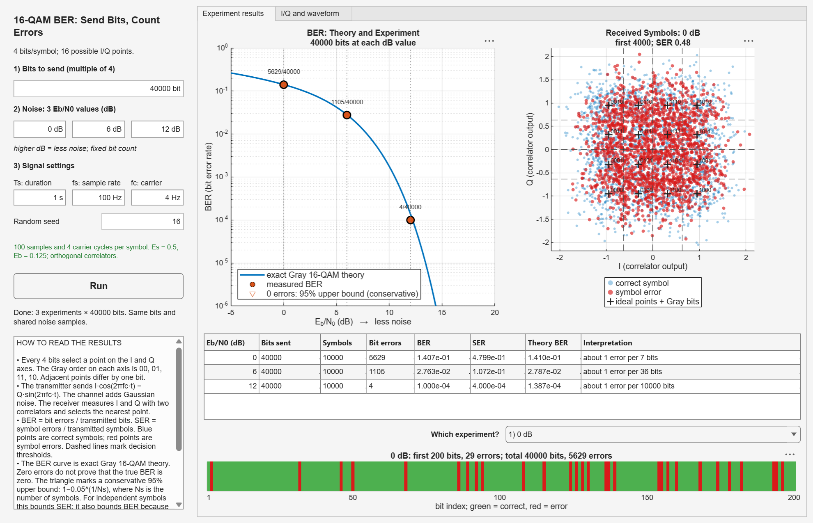
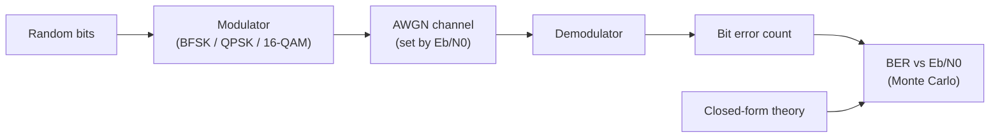

# BFSK, QPSK and 16-QAM: Modulation, Demodulation and BER Analysis

EE451 Communications term project (IYTE, Fall 2026).

We implement BFSK, QPSK and 16-QAM modulators/demodulators in MATLAB, simulate bit error rate (BER) over an AWGN channel, compare it with theoretical curves, and present everything in a MATLAB GUI. A wired modem between two ESP32 boards (DAC → wire → ADC) is a hardware plan; this repository does not yet establish measured hardware BER.

## 16-QAM experiment

Open [`teslim/qam16_standalone.m`](teslim/qam16_standalone.m) in MATLAB and click **Run** for the self-contained English experiment. You can also use the commands below from the repository root. It compares three noise levels, I/Q decisions and bit errors using the same layout as the BFSK GUI. No built-in modulation functions are needed. The modular launcher `start_qam16` remains available, and `qam16_tek_dosya.m` is retained as an English-text compatibility export.

```matlab
cd teslim
qam16_standalone   % Self-contained, single-file GUI
cd ..              % Return to the repository root
% Alternatively, open the modular project GUI:
start_qam16
% To run numerical checks and reproduce the results:
addpath('src')
test_qam16
run_qam16_analysis
```

[16-QAM explanation](docs/qam16/README.md) · [Presentation and instructor questions](docs/qam16/sunum_notlari.md) · [Validated results](results/qam16/README.md) · [English PDF summary](teslim/16QAM_Summary_and_Figures.pdf)



## How it works



| Step | What it does | Code |
|---|---|---|
| Modulation | Gray-mapped QPSK and 16-QAM (Es = 1), orthogonal BFSK tones | `src/qpsk_mod.m`, `qam16_mod.m`, `bfsk_mod.m` |
| Channel | Adds complex AWGN for a given Eb/N0 | `src/awgn_channel.m` |
| Demodulation | Sign / per-axis slicing for QPSK and 16-QAM, correlator bank for BFSK (noncoherent or coherent) | `src/*_demod.m` |
| Simulation | Runs until enough errors or bits are counted per Eb/N0 point | `src/ber_sim.m` |
| Theory | Closed-form BER for each scheme | `src/ber_theory.m` |

Everything is written from first principles, so the Communications Toolbox is not needed to run the core code. Formulas and details are in [`src/README.md`](src/README.md).

## Status

| Part | Folder | Status |
|---|---|---|
| Modulators and demodulators | `src/` | ✅ Done, sanity tests included |
| BER over AWGN (simulation vs theory) | `src/`, `results/` | ✅ Done (Week 1) |
| MATLAB GUI | `gui/` | ✅ BFSK and 16-QAM experiments; QPSK GUI pending |
| ESP32 breadboard modem | `hardware/` | 🟡 Plan, wiring diagrams and op-amp schematic added |
| Report and presentation | `docs/` | 🟡 Proposal added |

## Results

Simulated BER matches theory for all four schemes. Eb/N0 needed for BER = 10⁻³:

| Scheme | Eb/N0 | Bits/symbol |
|---|---|---|
| QPSK | 6.8 dB | 2 |
| BFSK (coherent) | 9.8 dB | 1 |
| 16-QAM | 10.5224 dB (exact inversion) | 4 |
| BFSK (noncoherent) | 11.0 dB | 1 |

Plots: [`results/ber_awgn.png`](results/ber_awgn.png), [`results/constellations.png`](results/constellations.png). Details in [`results/README.md`](results/README.md).

## Quick start

```matlab
cd src
test_mod_demod     % all tests should PASS
run_ber_awgn       % writes ../results/ber_awgn.png, constellations.png, ber_awgn.mat
```

## Repository layout

| Folder | Contents |
|---|---|
| `src/` | Modulation/demodulation functions, AWGN channel, BER simulation and theory |
| `gui/` | MATLAB App Designer GUI |
| `hardware/` | ESP32 breadboard modem: plan, wiring diagrams, firmware |
| `results/` | BER plots, constellations, saved data |
| `docs/` | [Proposal PDF in upstream repository](https://github.com/halilyilmaz16/bfsk-qpsk-16qam-ber/blob/main/docs/EE451_P7_Proposal_Report.pdf), report, presentation |

## Requirements

- MATLAB (core code in `src/` runs without toolboxes)
- Hardware part: two ESP32 DevKit (WROOM-32) boards, breadboard parts listed in [`hardware/README.md`](hardware/README.md)

## Team

- Halil Yilmaz
- Emir Dündar ([@Dundarzade](https://github.com/Dundarzade)) — 16-QAM experiment GUI and BER analysis
- Atlas Ferhan
