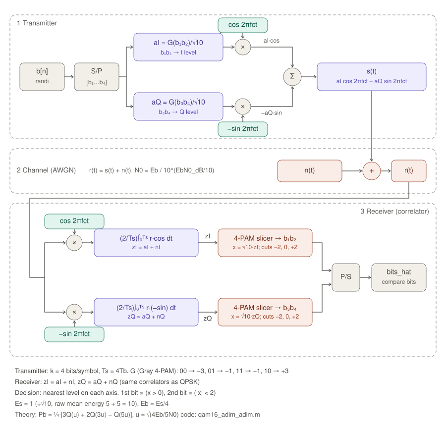
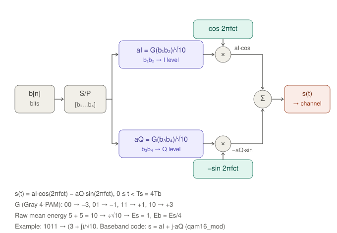
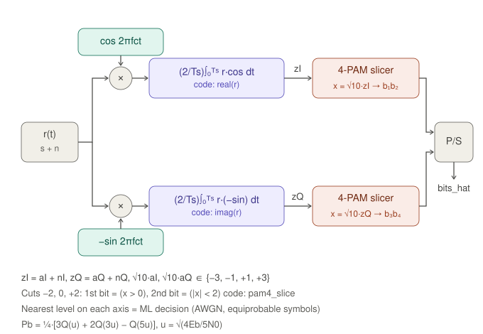
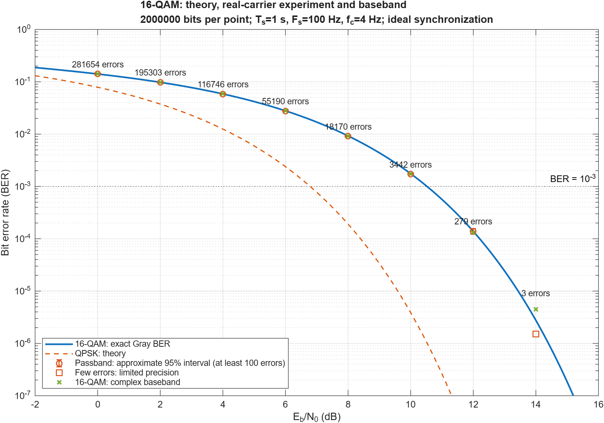
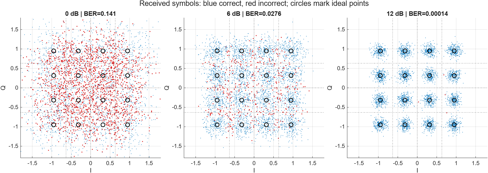
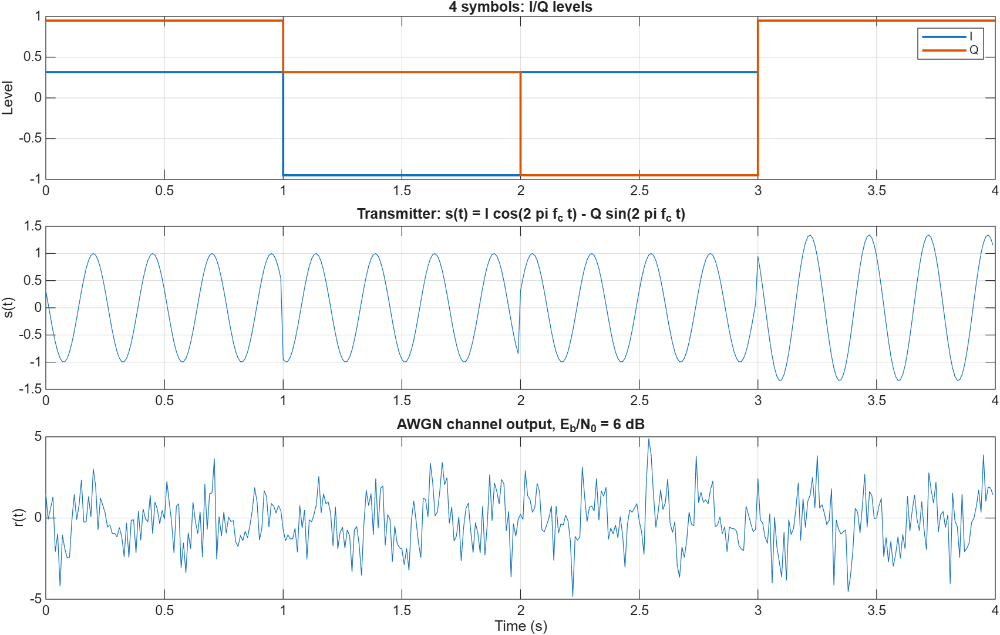

# 16-QAM: from bits to carrier and back

**16-QAM contribution: Emir Dündar ([@Dundarzade](https://github.com/Dundarzade)).**

16-QAM is a 16-point modulation scheme that carries **4 bits per symbol**. The first two bits select the I level; the last two select the Q level. The transmitter uses these two values to set the amplitude and phase of an analog carrier. The receiver estimates the same four bits from the noisy signal.

## Running the experiment and finding the files

Set the MATLAB current folder to the repository root:

```matlab
cd teslim
qam16_standalone                  % Self-contained, single-file 16-QAM experiment
cd ..                             % Return to the repository root
start_qam16                       % Launch the modular 16-QAM GUI
addpath('src');
out = qam16_experiment(40000, 6);  % Run one Eb/N0 point from code
run_qam16_analysis                % Generate BER, constellation and waveform results
```

The GUI defaults to 40,000 bits and compares $E_b/N_0$ values of 0, 6 and 12 dB. Inspect the decision thresholds and incorrect decisions in the constellation plot, the error counts and BER/SER in the table, and the error locations in the bit strip. The bit count must be a multiple of 4.

| File | Purpose |
|---|---|
| [`../../teslim/qam16_standalone.m`](../../teslim/qam16_standalone.m) | Self-contained English GUI; run `qam16_standalone` |
| [`../../start_qam16.m`](../../start_qam16.m) | Open the modular GUI from the repository root |
| [`../../gui/qam16_gui.m`](../../gui/qam16_gui.m) | GUI comparing three noise levels |
| [`../../src/qam16_experiment.m`](../../src/qam16_experiment.m) | Real carrier → AWGN → correlators → decisions |
| [`qam16_adim_adim.m`](qam16_adim_adim.m) | Teaching script explaining the full chain with 12 bits / 3 symbols |
| [`sunum_notlari.md`](sunum_notlari.md) | A 2–3 minute presentation outline and questions with answers |
| [`../../teslim/16QAM_Summary_and_Figures.pdf`](../../teslim/16QAM_Summary_and_Figures.pdf) | English summary and figures for submission |
| [`qam16_sistem.svg`](qam16_sistem.svg) | The complete system, from bits to bits |
| [`qam16_verici.svg`](qam16_verici.svg) | S/P, Gray 4-PAM and I/Q carriers |
| [`qam16_alici.svg`](qam16_alici.svg) | Two correlators and the decision stage |

Gray-labelled constellation: [`../genel/constellations_gray.svg`](../genel/constellations_gray.svg). The legacy filename `qam16_tek_dosya.m` is also retained as a compatibility export with English text.

## 1. The complete system

<picture>
  <source media="(prefers-color-scheme: dark)" srcset="qam16_sistem_dark.svg">
  
</picture>

The chain is **bits → groups of four → I/Q levels → carrier → noise → I/Q correlators → nearest point → bits**. The `%%` sections in `qam16_adim_adim.m` follow this order. Run the sections in sequence from the beginning; each later section uses variables from the previous ones.

## 2. Transmitter: four bits select one point

<picture>
  <source media="(prefers-color-scheme: dark)" srcset="qam16_verici_dark.svg">
  
</picture>

Each symbol has the form $[b_1\ b_2\ b_3\ b_4]$. Each axis uses Gray-coded 4-PAM mapping:

```math
G(00)=-3,\qquad G(01)=-1,\qquad G(11)=+1,\qquad G(10)=+3
```

```math
a=a_I+ja_Q=\frac{G(b_1b_2)+jG(b_3b_4)}{\sqrt{10}}
```

The I and Q values in the table are **raw levels**; the actual point is $(I+jQ)/\sqrt{10}$.

| Bits | I | Q | Bits | I | Q |
|---|---:|---:|---|---:|---:|
| `0000` | −3 | −3 | `1000` | +3 | −3 |
| `0001` | −3 | −1 | `1001` | +3 | −1 |
| `0010` | −3 | +3 | `1010` | +3 | +3 |
| `0011` | −3 | +1 | `1011` | +3 | +1 |
| `0100` | −1 | −3 | `1100` | +1 | −3 |
| `0101` | −1 | −1 | `1101` | +1 | −1 |
| `0110` | −1 | +3 | `1110` | +1 | +3 |
| `0111` | −1 | +1 | `1111` | +1 | +1 |

With Gray coding, horizontal or vertical nearest neighbours differ by one bit. This reduces bit errors when noise mainly moves decisions to these neighbours. Changing only the bit labels does not improve point spacing or symbol error probability.

**Why $\sqrt{10}$?** For equally likely symbols, the mean square of each raw axis is $(9+1+1+9)/4=5$. The two axes give 10 in total; dividing by $\sqrt{10}$ makes $\mathbb{E}[|a|^2]=1$. This does not mean every point has energy 1; their average energy is 1.

During one symbol, with $T_s=4T_b$:

```math
s(t)=a_I\cos(2\pi f_ct)-a_Q\sin(2\pi f_ct)
     =A\cos(2\pi f_ct+\phi),\quad
A=\sqrt{a_I^2+a_Q^2},\quad\phi=\operatorname{atan2}(a_Q,a_I)
```

For example, `1011` gives $a=(3+j)/\sqrt{10}$, $A=1$ and $\phi\approx18{,}435^\circ$. Four digital bits are therefore carried by an analog wave with a particular amplitude and phase for one symbol interval. Sixteen points do not mean sixteen distinct amplitudes and sixteen distinct phases: square 16-QAM has three amplitude levels, $\sqrt{0{,}2}$, $1$ and $\sqrt{1{,}8}$, combined with different phases.

## 3. Energy and AWGN: distinguish the two scales

`qam16_mod` produces only complex symbols; their average symbol energy is taken as **1** in this representation. `qam16_experiment` uses these coefficients to generate **real carrier samples**. The cos/sin carriers used here have energy $T_s/2$ over one symbol, so:

```math
E_s=\mathbb{E}\!\left[\int_0^{T_s}s^2(t)\,dt\right]
   =\frac{T_s}{2}\mathbb{E}[|a|^2]=\frac{T_s}{2},
\qquad E_b=\frac{E_s}{4}=\frac{T_s}{8}
```

Thus, for $T_s=1$, the passband experiment has average values $E_s=0{,}5$ and $E_b=0{,}125$, consistent with the unit-energy symbol representation. These are averages over the equally likely symbol set; the measured average for a finite random bit sequence may differ slightly.

The channel adds additive white Gaussian noise (AWGN):

```math
r[n]=s[n]+n[n],\qquad
\gamma_b=10^{(E_b/N_0)_{\mathrm{dB}}/10},\quad
N_0=\frac{E_b}{\gamma_b},\quad
n[n]\sim\mathcal{N}\!\left(0,\sigma^2\right),\quad
\sigma^2=\frac{N_0F_s}{2}
```

$N_0/2$ is the two-sided power spectral density of the real noise. As the sampling rate $F_s$ increases, the variance per sample increases too; the correlator's $1/F_s$ integration step balances this scaling. We therefore cannot directly apply the noise variance for a single unit-energy complex symbol to real carrier samples. The factor-of-two distinction between real and complex signal noise is also described in the [MathWorks AWGN Channel documentation](https://www.mathworks.com/help/comm/ref/awgnchannel.html).

The experiment defaults are `Ts=1`, `Fs=100`, `Fc=4` and `Seed=16`. $F_sT_s$ must be an integer number of samples, $f_cT_s$ must be an integer number of carrier periods, and $f_c<F_s/2$ is required. This makes the sampled cos and −sin carriers orthogonal over one symbol. The teaching script samples the same model more densely (`fs=1000`).

## 4. Receiver: two correlators and decisions

<picture>
  <source media="(prefers-color-scheme: dark)" srcset="qam16_alici_dark.svg">
  
</picture>

Over each symbol interval, the receiver multiplies the signal by cos and −sin and integrates:

```math
z_I=\frac{2}{T_s}\int_0^{T_s}r(t)\cos(2\pi f_ct)\,dt=a_I+n_I,
\qquad
z_Q=\frac{2}{T_s}\int_0^{T_s}r(t)[-\sin(2\pi f_ct)]\,dt=a_Q+n_Q
```

In the code, the integral is the sample sum multiplied by $1/F_s$. The $2/T_s$ factor compensates for the carrier energy and returns the receiver to the modulator's I/Q scale. The output noise variance of each branch is $N_0/T_s=1/(8\gamma_b)$, giving the same decision statistics as the unit-energy baseband model.

Undo the normalisation: $x_I=\sqrt{10}\,z_I$, $x_Q=\sqrt{10}\,z_Q$. Each axis selects the nearest level in $\{-3,-1,+1,+3\}$. The raw thresholds are $-2,0,+2$; the constellation thresholds are $\{-2,0,+2\}/\sqrt{10}$.

```matlab
b1 = xI > 0;      b2 = abs(xI) < 2;
b3 = xQ > 0;      b4 = abs(xQ) < 2;
```

This is equivalent to the `pam4_slice` decision in [`qam16_demod.m`](../../src/qam16_demod.m). For AWGN and equally likely symbols, the nearest point is the maximum-likelihood (ML) symbol decision. Exact threshold ties are resolved by the code's `>` and `<` rules; this event has probability zero under continuous Gaussian noise.

This receiver knows the **ideal symbol timing and carrier phase/frequency**. The experiment does not include a synchronisation circuit that estimates them.

## 5. BER, SER and the difference from QPSK

BER is the number of incorrect bits divided by the total bit count. SER is the fraction of symbols with at least one incorrect bit. One symbol error can cause several bit errors, so `BER = SER/4` does not hold in every case.

For Gray-coded square 16-QAM with equally likely bits, an ideally synchronised receiver and AWGN, the exact BER is:

```math
P_b=\frac{3Q(u)+2Q(3u)-Q(5u)}{4},\qquad
u=\sqrt{0{,}8\gamma_b},\qquad
Q(x)=\frac12\operatorname{erfc}\!\left(\frac{x}{\sqrt2}\right)
```

The approximation $P_b\approx\tfrac34Q(u)$ applies only at high $E_b/N_0$. The project's [`ber_theory('qam16', ...)`](../../src/ber_theory.m) uses the exact expression. This is the $M=16$ case of the [MathWorks square M-QAM BER expression](https://www.mathworks.com/help/comm/ug/analytical-expressions-used-in-berawgn-function-and-bit-error-rate-analysis-app.html).

For 16-QAM, $R_b=4R_s$; for QPSK, $R_b=2R_s$. At the same bit rate, 16-QAM uses half the symbol rate of QPSK. With the same pulse shaping and roll-off, this gives a narrower bandwidth. The rectangular symbol pulses used here have spectral sidelobes; an exact occupied bandwidth cannot be inferred from the 4 bits/symbol figure alone.

The trade-off is greater sensitivity to noise. At a theoretical BER of $10^{-3}$, QPSK requires about **6.8 dB** and 16-QAM about **10.5 dB**, a difference of about **3.7 dB**. These values are calculated from the theoretical curves; they do not imply a constant 4 dB gap at every BER.

## 6. Generating and interpreting the results

[`run_qam16_analysis.m`](../../src/run_qam16_analysis.m) creates reproducible simulation results under `results/qam16/`. These are not hardware measurements. Read numerical results together with their error and bit counts from [`qam16_ber.csv`](../../results/qam16/qam16_ber.csv); the MATLAB data are in [`qam16_results.mat`](../../results/qam16/qam16_results.mat).







As $E_b/N_0$ increases, we expect the points to cluster more tightly around their ideal positions and BER to decrease. With a finite sample count, simulation does not match theory exactly. Observing zero errors in one run does not prove that the true BER is zero; it only means no errors were observed in that many bits. More bits are needed to interpret high-$E_b/N_0$ points.

With zero errors in $N_s$ independent symbols, the one-sided 95% SER upper bound is $1-0{,}05^{1/N_s}$. Since BER ≤ SER, this is also a conservative BER upper bound. This avoids assuming independence between bit errors within the same symbol.

## 7. Moving to ESP32: no hardware measurements yet

[`hardware/README.md`](../../hardware/README.md) is a **draft plan** for a wired, low-frequency modem between two ESP32 boards. The MATLAB results do not demonstrate that this hardware works or establish its BER.

To distinguish 16-QAM levels in hardware, the ADC/DAC amplitude scale, DC offset and channel gain must be calibrated; clipping must be avoided; and carrier phase/frequency and symbol timing must be synchronised. A receiver that checks only the sign is insufficient: it must distinguish inner and outer amplitude levels too.

The sampling plan also needs validation. For the classic **ESP32**, **ESP-IDF v5.5.1** defines `SOC_ADC_SAMPLE_FREQ_THRES_LOW` as **20 kHz**. The planned 8 kHz must therefore not be treated as a sampling rate that can be passed directly to this version's built-in continuous ADC driver. A higher sampling rate followed by suitable filtering/decimation, or another sampling method, must be selected; the final choice must be tested with the board and driver. Source: [Espressif v5.5.1 ESP32 `soc_caps.h`](https://github.com/espressif/esp-idf/blob/v5.5.1/components/soc/esp32/include/soc/soc_caps.h).
