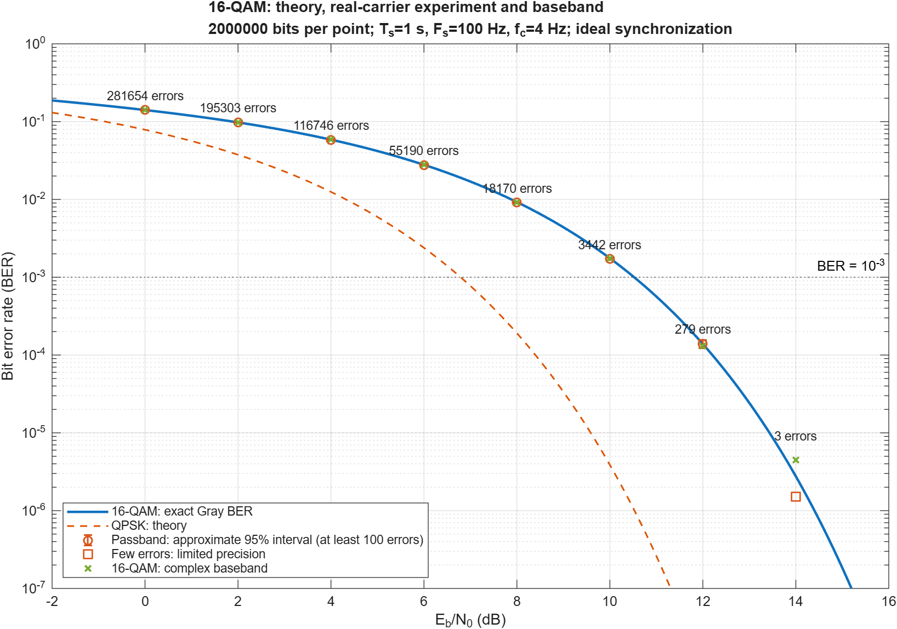
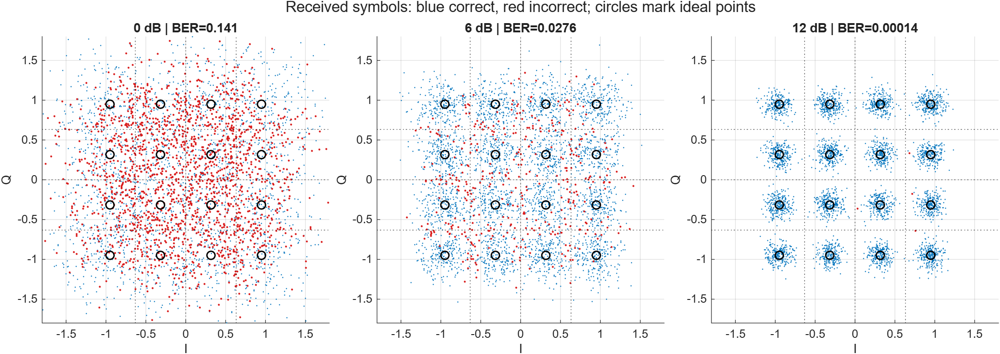
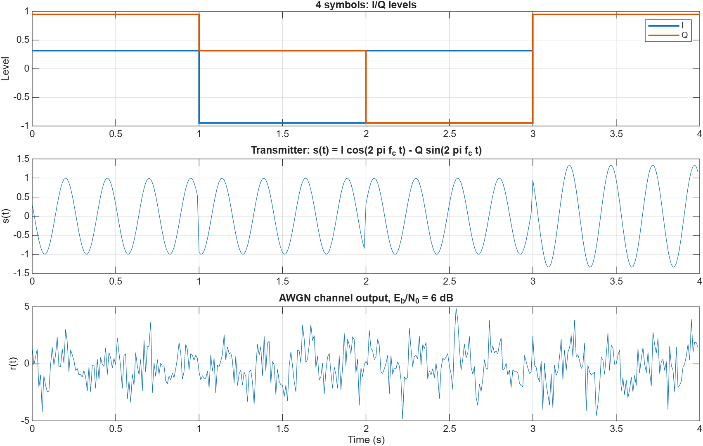

# 16-QAM validation results

Generated on 17 November 2026 with MATLAB R2026b Prerelease Update 1. Source: `src/run_qam16_analysis.m`; 2,000,000 bits per point, Ts=1 s, Fs=100 Hz, fc=4 Hz, seed=451. These are ideally synchronised AWGN simulations, not physical hardware measurements.

| Eb/N0 | Incorrect bits | Measured BER | Exact theoretical BER |
|---|---:|---:|---:|
| 0 dB | 281654 | 0.140827 | 0.140982 |
| 4 dB | 116746 | 0.058373 | 0.058624 |
| 8 dB | 18170 | 0.009085 | 0.009247 |
| 12 dB | 279 | 0.0001395 | 0.0001387 |
| 14 dB | 3 | 0.0000015 | 0.0000028 |

Only three errors were counted at 14 dB, so the precision of that point is limited. Approximate 95% error bars are shown only for points with at least 100 errors. The standard error is calculated per symbol, preserving the dependence between bits in the same symbol. Since the points use common standard noise samples, they are not independent repetitions.

Numerical inversion of the exact theory for BER=10⁻³ gives **16-QAM 10.5224 dB**, **QPSK 6.7895 dB**, a difference of **3.7329 dB**. This is a theoretical result for that target, not a constant power gap at every BER.







## Files and reproduction

- `qam16_ber.csv`: all counts, baseband comparisons and standard errors for the eight Eb/N0 points.
- `qam16_results.mat`: result table, settings and theoretical targets.
- `qam16_gui.png`: GUI screenshot after all three experiments have run.
- `qam16_ber.png`, `qam16_constellations.png`, `qam16_waveform.png`: the plots above.
- [English PDF summary and figures](../../teslim/16QAM_Summary_and_Figures.pdf).

```matlab
% From the project root:
addpath('src','gui')
test_mod_demod
test_qam16
run_qam16_analysis
f = qam16_gui(struct('Visible','off','AutoRun',true, ...
    'ExportDir',fullfile(pwd,'results','qam16')));
close(f)
```

Checks cover all 16 labels, Gray adjacency, Es=1 normalisation, zero errors for a noiseless real waveform, theoretical BER, sample and correlator noise variance, BER agreement when Fs/Ts changes, and rejection of invalid settings. The GUI's three experiments and result structure were validated in real MATLAB. These statements describe the recorded validation run above.
